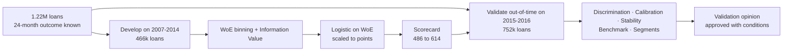
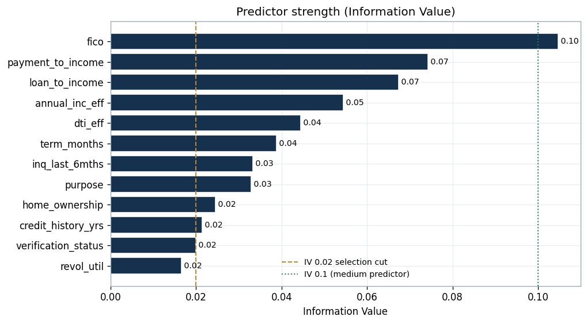
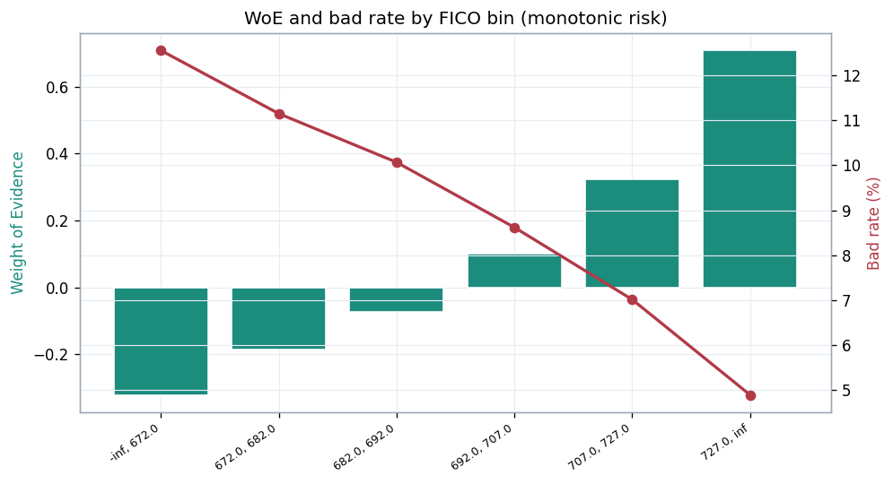
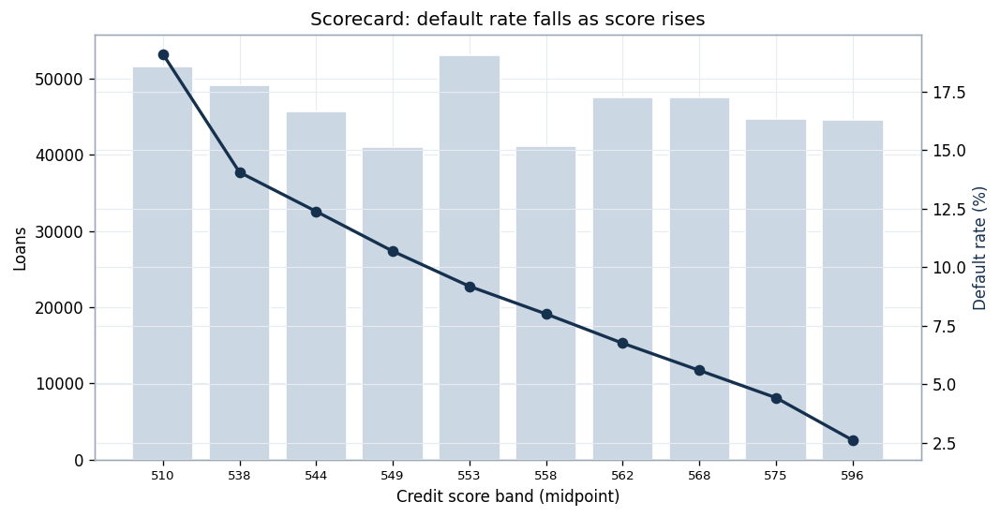
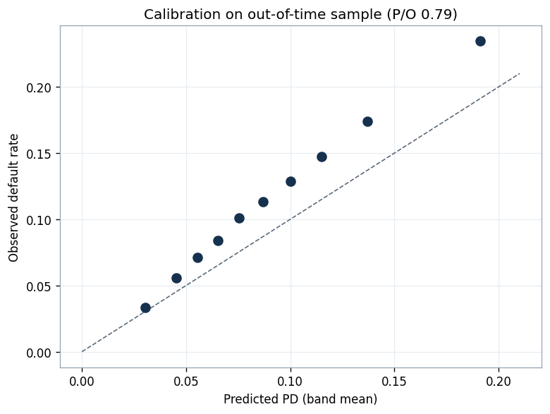
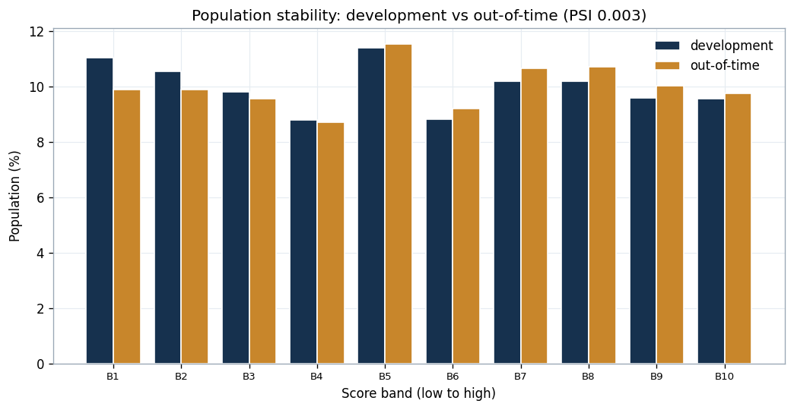
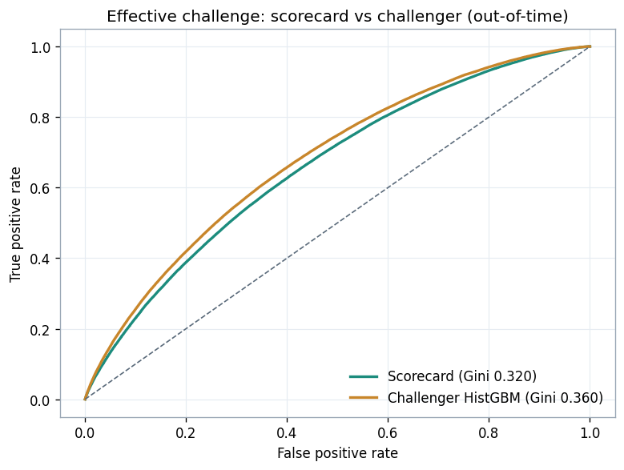
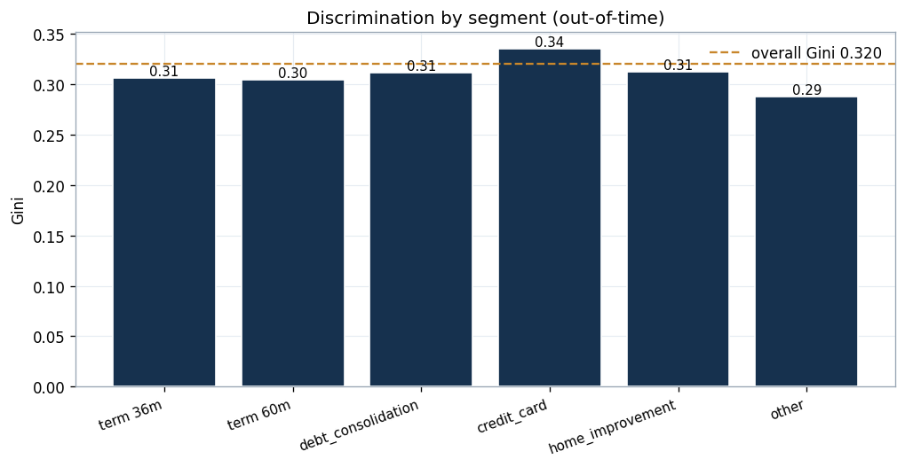

# PD Scorecard and Independent Model Validation

**A credit-scoring scorecard built the way banks build them, and then independently validated the way a second line of defence challenges a first-line model.**

This project has two halves. First it develops a probability-of-default application scorecard on 1.22 million real Lending Club loans with a known 24-month outcome, using the standard industry method: Weight of Evidence, Information Value, a logistic fit, and a points-based score. Then it puts on the independent-validation hat and challenges that scorecard across the five areas a model risk function cares about: discrimination, calibration, stability, benchmarking, and segment performance. The full write-up is in [`VALIDATION_REPORT.md`](VALIDATION_REPORT.md).

The validation is the point. It produces a real, material finding rather than a clean bill of health, which is exactly what effective challenge is for.

---

## Headline: the validation opinion

**Approved with conditions.** The scorecard ranks risk adequately and stably, but it under-predicts the level of default on recent vintages and needs recalibration before any use that relies on the PD level.

The "bad" outcome is default within 24 months of issue, on every loan whose whole 24-month window had passed by the data snapshot (March 2019). Development uses loans issued up to 2014 (466,340); out-of-time validation uses loans issued in 2015-2016 (751,956).

| Validation area | Metric | Result | Standard | Rating |
|---|---|---|---|---|
| Discrimination | Gini, out-of-time | 0.320 | 0.30 or above | GREEN |
| Calibration | predicted / observed PD | 0.79 | 0.90 to 1.10 | RED |
| Stability | PSI, development vs out-of-time | 0.003 | below 0.10 | GREEN |
| Effective challenge | Gini gap to challenger | +0.040 | below 0.05 | GREEN |
| Segment performance | Gini across segments | 0.29 to 0.34 | close to overall (judgement) | GREEN |

Fit for ranking and approval decisions; not yet fit for risk-based pricing or IFRS 9 ECL until the central tendency is recalibrated.

---

## The scorecard



Each characteristic is binned and converted to a Weight of Evidence, predictors are selected by Information Value, a logistic regression is fitted on the WoE values, and the result is scaled to points (20 points to double the odds, anchored at 600 for odds of 50 to 1). Ten characteristics were retained (IV at or above 0.02), led by FICO (0.105), payment-to-income (0.074) and loan-to-income (0.067). The platform's own grade and interest rate were excluded so the model earns its signal independently.

---

## The validation

Five tests, on an out-of-time sample the model was never trained on:

- **Discrimination (GREEN, just).** Out-of-time Gini 0.320 and KS 0.228, level with development (Gini 0.318). The 24-month default rate falls steadily from 19% in the lowest score band to 2.6% in the highest. The Gini sits only just above the 0.30 line, which is typical for an approved-only population with a narrow FICO range.
- **Calibration (RED, the material finding).** The predicted-to-observed PD ratio is 0.79, and every band sits above the diagonal on the calibration plot. The development vintages defaulted at 9.4% within 24 months against 11.6% for 2015-2016, so the model's central tendency is anchored too low for the recent book. This must be recalibrated before any PD-level use.
- **Stability (GREEN).** PSI of 0.003 between development and out-of-time vintages. Worth pairing with the calibration finding: the population is stable, but the default rate per score has risen, so stability of the population does not imply calibration of the PD.
- **Effective challenge (GREEN, watch).** A gradient-boosting challenger reaches Gini 0.360 versus the scorecard's 0.320, a gap of 0.040 that sits inside tolerance. The scorecard's transparency justifies keeping it, with the small gap flagged for the next redevelopment.
- **Segment performance (GREEN).** Gini holds between 0.29 and 0.34 across both terms and the four largest loan purposes, close to the overall 0.32. There is no coded threshold for this test; the rating is a judgement.

---

## Figures, with interpretation

**Predictor strength.** 
Information Value by characteristic, with the selection cut and the medium-predictor line marked.

**A clean characteristic.** 
Weight of Evidence rises monotonically with FICO while the 24-month bad rate falls from 12.6% to 4.9%, the pattern a validator wants to see.

**The score works.** 
The 24-month default rate falls smoothly from 19% to 2.6% across the score bands (development sample). Monotonic rank-ordering.

**The material finding.** 
Every band lies above the diagonal: observed default exceeds predicted PD everywhere. This is the under-prediction the validation flags.

**Population stability.** 
Development and out-of-time score distributions overlay closely (PSI 0.003). The population is stable even though the central default rate has drifted.

**Effective challenge.** 
The scorecard against a gradient-boosting challenger out of time. The challenger is modestly ahead, not decisively so.

**Across segments.** 
Discrimination is consistent by term and purpose, all close to the overall Gini.

---

## Why it is built this way

A second line does not rebuild the business's models for them; it challenges them. So this project deliberately does the standard scorecard build, then tests it the way a validator would and reaches a conditional opinion with findings and recommendations, captured in a RAG-rated report. The most useful output is not a high score but the calibration finding, because surfacing that before a model is used for pricing or impairment is exactly what model oversight is for.

---

## Run it

```bash
pip install -r requirements.txt
# download accepted_2007_to_2018Q4.csv.gz from Kaggle into data/raw/ (or set LENDING_CLUB_CSV to its path)
python build_dataset.py   # builds data/lending_affordability.parquet: all 2.26M loans with outcome windows
python analysis.py        # builds the scorecard, runs the validation, writes figures and results.json
pip install jupytext nbclient ipykernel && python make_notebook.py   # optional: rebuild the notebook
```

The notebook is generated from `analysis.py` (written in notebook cell format) and executed, so the two always match.

## Repository structure

```
.
├── analysis.py                     # scorecard development + full validation (cells marked for the notebook)
├── pd_scorecard_validation.ipynb   # generated from analysis.py and executed
├── VALIDATION_REPORT.md            # the formal independent validation report (read this)
├── results.json                    # all metrics quoted here and in the report
├── CHANGES.md                      # what changed and why, with old and new numbers
├── build_dataset.py                # builds the modelling table from the raw Kaggle file
├── lending_club.py                 # shared loader: outcome windows, snapshot, default dating
├── make_notebook.py                # converts analysis.py to the notebook and runs it
├── figures/                        # seven charts
├── data/
│   ├── scorecard_table.csv         # the points scorecard (characteristic, bin, WoE, points)
│   └── scored_dev_sample.csv       # sample of scored accounts
├── requirements.txt
├── LICENSE
└── README.md
```

## Limitations

- **Approved loans only**, with no reject inference: the scorecard has never seen declined applicants, so it would not transfer directly to a full applicant population, and the narrow FICO range limits discrimination.
- **Approximate default dating.** The file has no delinquency history, so default is dated at last payment plus four months.
- **One out-of-time period** (2015-2016 issues), observed through a benign US credit environment.
- **Quantile binning.** A production build would use monotonic optimal binning; it would not change the conclusions.

## Data

The underlying **Lending Club** loan data (accepted loans 2007-2018, via Kaggle) is publicly available and used here for a non-commercial portfolio project; neither the raw file nor the derived modelling table is redistributed. The **code** is released under the MIT License (see `LICENSE`).
